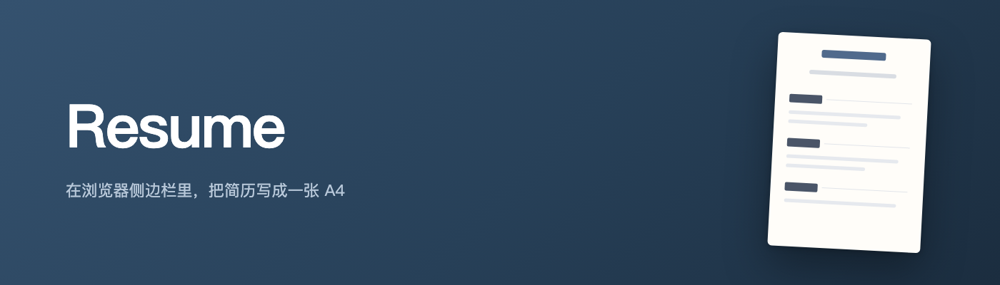
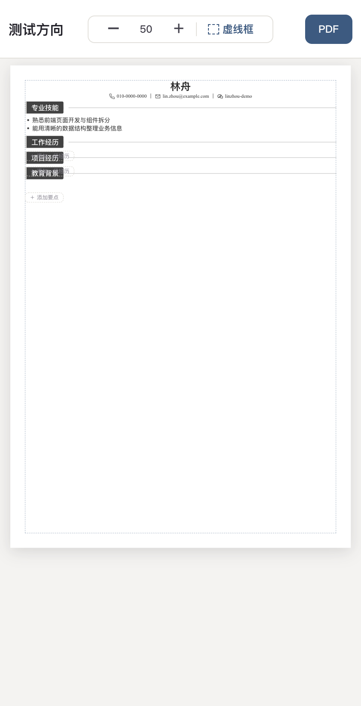
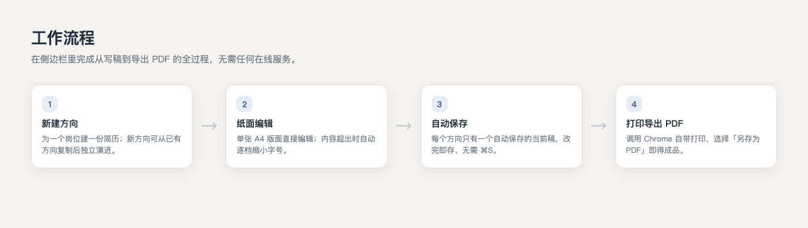
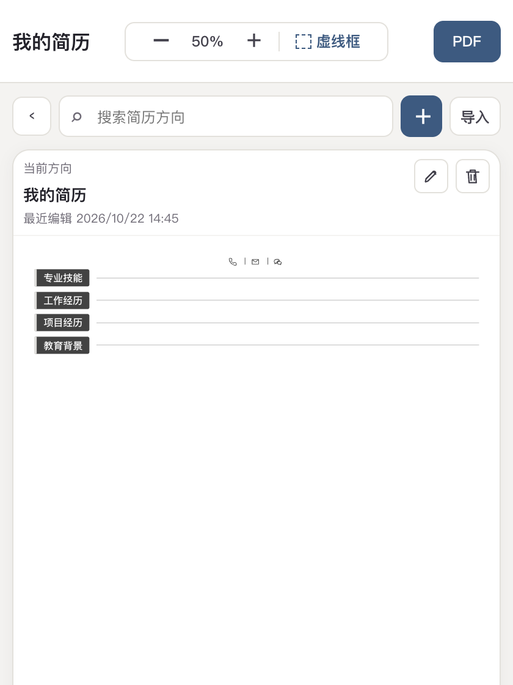

<p align="center">
  
</p>

<h1 align="center">Resume</h1>

<p align="center">
  <b>在浏览器侧边栏里，把简历写成一张 A4。</b><br>
  Chrome 侧边栏扩展 · 多方向自动保存 · 一键打印成 PDF · 纯本机
</p>

<p align="center">
  
  
  
  
</p>

---

## 这是什么

**Resume** 是一个 Chrome 侧边栏扩展，专门用来做简历：在一条窄侧栏里直接编辑排版好的 A4 简历，改完**自动保存**，最后用 Chrome 自带的打印「另存为 PDF」，得到一份可以直接投递的简历。

不需要在线服务、不接 AI、不读取网页内容——整个过程中只有你和你的简历。

<p align="center">
  
</p>

## ✨ 主要特性

- **多方向**：一个方向对应一份简历（比如针对不同岗位），彼此独立；新方向可从已有方向复制后独立演进。
- **自动保存**：没有 ⌘S，改完即存；每个方向只保留一份自动保存的当前稿。
- **单页 A4**：版面固定为一张 A4，内容超出时**自动逐档缩小字号**，尽量不翻页。
- **一键 PDF**：调用 Chrome 自带打印，选「另存为 PDF」即得成品。
- **缩放与虚线框**：顶栏实时显示缩放比例，可一键显示 9mm 虚线框确认边距。
- **拖拽排序**：悬停要点或经历行，从左侧抓手拖动即可在该列表内重新排序。
- **纯本机**：只申请 `storage` 与 `sidePanel` 权限，不读网页、不申请任何网站访问权限。

## 🎬 工作流程

<p align="center">
  
</p>

## 📸 界面

**简历方向室**（搜索、新建、导入、改名、删除）

<p align="center">
  
</p>

> 截图为扩展真实界面，示例内容均为虚构。

## 🚀 快速开始

直接加载即可使用，无需构建：

1. 打开 Chrome 的 `chrome://extensions`；
2. 开启右上角「开发者模式」；
3. 点击「加载已解压的扩展程序」，选择仓库里的 `extension/` 目录；
4. 点击扩展图标打开 Resume 侧边栏。

### 开发与测试

```bash
npm test                # 领域规则单元测试（extension/*.test.mjs）
npm run build:extension # 生成 dist-extension/ 可再生产物
```

## 🗂 项目结构

```text
extension/
├── sidepanel.html / sidepanel.mjs  # 侧边栏：方向室、纸面编辑、快捷键、自动保存、打印
├── domain-*.mjs                    # 纯领域规则（测试与源码同目录）
├── print.html / print.mjs          # 打印预览页
├── service-worker.js               # 打开侧边栏
└── icons/                          # 扩展图标
```

> `design-handoff/` 与 `prototypes/` 是设计与交互探索的留档，仅作参考，不参与扩展运行。

## ⌨️ 常用操作

| 操作 | 方式 |
|---|---|
| 打开 / 关闭方向室 | ⌘F（macOS）/ Ctrl+F |
| 显示 9mm 虚线框 | 顶栏「虚线框」 |
| 缩放 | 顶栏 − / ＋，点击中间数字可直接输入比例 |
| 排序要点 / 经历 | 悬停该行 → 从左侧抓手拖动 |
| 导出 PDF | 顶栏「PDF」→ Chrome 打印 → 另存为 PDF |

## 🔒 数据与隐私

- 只申请 `storage` 与 `sidePanel` 权限；
- 不读取网页、不接入 AI、不申请任何网站访问权限；
- 简历数据保存在本机扩展存储中，不上传。

## ⚠️ 已知边界

- 面向个人本机使用；建议在本机实际验收中文输入法、Chrome 快捷键、侧边栏宽度与最终打印效果。
- 每个方向只保留一份自动保存的当前稿，不提供快照 / 历史版本 / 废件箱。

## 📄 License

本项目采用 [MIT License](LICENSE)。

---

<p align="center"><sub>Resume · A4 résumé in your Chrome side panel</sub></p>
